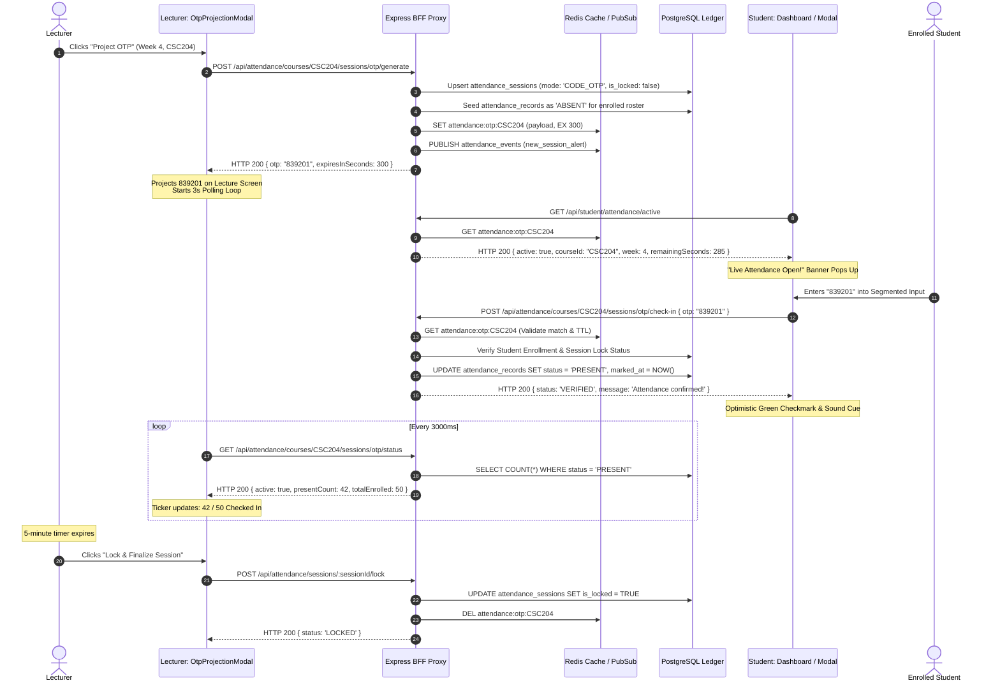

# Phase 19 Implementation Plan: Student Attendance Ecosystem & Multi-Modal Sync Bridge

**Role:** Staff Systems Architect & Zero-Trust Client Lead  
**Document Status:** 📋 PROPOSED (Pre-Execution Architectural Defense)  
**Subsystems:** `lecturer` (Lecturer Workspace & Verification Desk) ↔ `packages/bff` (Express BFF, PostgreSQL 16, Redis L1/L2) ↔ `packages/frontend` (Student Dashboard & Course Rooms)  
**Governing Standard:** The 8-8-8 Architectural Doctrine (`focit-architect`)  

---

## 1. Executive Architectural Blueprint

Currently, the FOCIT LMS possesses a sophisticated 4-mode attendance backend (`packages/bff/src/routes/attendance.js`) and a complete faculty-facing portal (`lecturer/frontend/src/components/attendance/` and `packages/frontend/src/pages/LecturerDashboardPage.jsx`). Lecturers can initiate live roll calls, project ephemeral 5-minute cryptographic OTPs, accept course representative lab sheets, and digitize snapped paper attendance sheets with OCR verification desk auditing.

However, the **Student Dashboard** (`packages/frontend/src/pages/DashboardPage.jsx`) and **Course Detail Room** (`packages/frontend/src/pages/CourseDetailPage.jsx`) are completely disconnected from this attendance engine:
1. **Zero Visibility into Attendance Telemetry:** Students have no real-time indicator of their cumulative attendance percentage or their compliance with the mandatory **National Universities Commission (NUC) 75% examination eligibility threshold**.
2. **Missing Ingress for Mode 2 Dynamic OTP:** When a lecturer projects a 6-digit OTP in the lecture hall or virtual classroom, students have no UI interface to input their passcode to register attendance.
3. **No Course-Level Audit Ledger:** The course detail tab bar lacks an "Attendance" tab, preventing students from inspecting weekly session statuses (Present, Absent, Excused) or filing verification disputes before sessions are finalized.
4. **Unleveraged Course Representative Elevation:** When a student is appointed as a `course_representative` (in `course_representatives`), their student portal fails to surface their elevated permissions (such as direct lab check-in or scanned sheet uploads).

This Phase 19 milestone builds the **Student Attendance System** and establishes the bidirectional operational bridge linking the **Lecturer Attendance Console** with the **Student Dashboard**.

```
┌─────────────────────────────────────────────────────────────────────────────────────────────────────────┐
│                                   LECTURER PLANE (Faculty Workspace)                                    │
│                                                                                                         │
│  Mode 1: Live Roll Call Modal (Manual single-click roster marking)                                      │
│  Mode 2: Dynamic OTP Projection Modal (5-minute countdown, live check-in ticker, crypto randomInt)       │
│  Mode 3: Course Rep Lab Direct Modal (Lab session check-in batch)                                       │
│  Mode 4: Scanned Sheet Upload & Verification Desk (Physical paper OCR, photo signatures, override desk)│
│  Finalization: Session Lock Button (Sets is_locked = TRUE, establishing NUC audit immutability)         │
└────────────────────────────────────┬────────────────────────────────────────────────────────────────────┘
                                     │
                                     │ Redis Key: attendance:otp:{courseId} (TTL: 300s)
                                     │ PostgreSQL: attendance_sessions & attendance_records
                                     │ PG LISTEN/NOTIFY & Redis PubSub: attendance_events
                                     ▼
┌─────────────────────────────────────────────────────────────────────────────────────────────────────────┐
│                                     COMPUTE PLANE (Express BFF Proxy)                                   │
│                                                                                                         │
│  - GET  /api/student/attendance/summary          (Aggregated attendance % across all enrolled courses)  │
│  - GET  /api/student/attendance/active           (Probes Redis for active live OTP check-ins)           │
│  - POST /api/attendance/courses/:cId/sessions/otp/check-in  (Atomically verifies & marks student PRESENT)│
│  - GET  /api/courses/:cId/attendance             (Student-scoped weekly timeline with photo redactions) │
│  - GET  /api/student/courses/rep-assignments     (Detects if student is an appointed Course Rep)        │
└────────────────────────────────────┬────────────────────────────────────────────────────────────────────┘
                                     │
                                     │ HTTPS / HttpOnly Cookie + Session Nonce
                                     │ RFC 7807 Error Boundaries & Mutation Locks
                                     ▼
┌─────────────────────────────────────────────────────────────────────────────────────────────────────────┐
│                                  STUDENT PLANE (Zero-Trust Client UI)                                   │
│                                                                                                         │
│  1. Student Dashboard (/dashboard):                                                                     │
│     - Attendance Telemetry Card: Overall Semester Rate (%) & 75% NUC Threshold Meter                   │
│     - Active Lecture Check-in Alert Banner: Real-time pulse when lecturer opens OTP session             │
│     - Course Cards: Enriched with per-course attendance rate badge & exam eligibility tag               │
│                                                                                                         │
│  2. Live OTP Check-In Dialog (<StudentOtpCheckInModal />):                                              │
│     - 6-Box Segmented Numeric Input with auto-focus, paste parsing, and mutation lock                    │
│     - Live sync countdown timer matching lecturer's projection countdown                                │
│     - Instant optimistic UI update with TanStack Query cache invalidation                               │
│                                                                                                         │
│  3. Course Detail Attendance Tab (/courses/:courseId?tab=attendance):                                  │
│     - Weekly Session Audit Matrix (Weeks 1 to 15, Date, Status, Mode, Verification Confidence)           │
│     - NUC Examination Qualification Meter (Sessions attended vs minimum sessions needed for 75%)        │
│     - Course Rep Action Pod (Rendered only if student is designated Course Representative for course)   │
└─────────────────────────────────────────────────────────────────────────────────────────────────────────┘
```

---

## 2. In-Depth Analysis: The Lecturer Attendance Implementation

Inspection of `lecturer/backend/src/routes/attendance.js` and `lecturer/frontend/src/components/attendance/` reveals the following architectural mechanics:

### 2.1 The 4 Modes of Ingestion
1. **Mode 1: Live Roll Call (`LiveRollCallModal.jsx` / `POST /courses/:courseId/sessions/roll-call`)**
   - Lecturer selects the academic week (1–15) and session date.
   - Loads enrolled roster (`/lecturer/courses/:courseId/students`).
   - Lecturer marks status (`PRESENT`, `ABSENT`, `EXCUSED`) via single-click bulk toggles or per-student checkboxes.
   - Commits to `attendance_sessions` and `attendance_records` with `verification_method = 'ROLL_CALL'`.
2. **Mode 2: Ephemeral Passcode Projection (`OtpProjectionModal.jsx` / `POST /courses/:courseId/sessions/otp/generate`)**
   - Lecturer specifies the week number and initiates code generation.
   - Express BFF validates staff allocation and ensures the session is not locked (`is_locked = FALSE`).
   - Upserts `attendance_sessions` with `session_mode = 'CODE_OTP'`.
   - Populates initial `ABSENT` records for all registered students.
   - Generates a 6-digit cryptographic PIN (`crypto.randomInt(100000, 1000000)`) with a 300-second TTL.
   - Stores PIN in Redis at key `attendance:otp:${courseId}` and in-memory fallback.
   - Lecturer's modal displays the PIN on a projector screen, polling `GET /courses/:courseId/sessions/otp/status` every 3,000ms to observe a live check-in tally (`presentCount` / `totalEnrolled`).
3. **Mode 3: Course Rep Lab Direct Check-in (`RepDirectModal.jsx` / `POST /courses/:courseId/sessions/rep-direct`)**
   - Designated Course Reps (verified via `course_representatives`) record lab or tutorial attendance directly.
   - Submits records marked with `verification_method = 'MANUAL_OVERRIDE'`.
   - Triggers an automated faculty notification to the lecturer: *"📝 Course Rep Lab Attendance Submitted. Review and lock."*
4. **Mode 4: Scanned Paper Sheet Upload & AI OCR (`CourseRepUploadModal.jsx` & `AttendanceVerificationDeskModal.jsx`)**
   - Course Rep snaps smartphone photos of the physical paper sign-in sheet and uploads them via multi-part streaming (`Busboy`).
   - Stored in `.cache/sheets/` and indexed in `attendance_sessions.sheet_image_urls`.
   - Lecturer opens the **Verification Desk Modal**, viewing the high-resolution sheet photos alongside extracted student rows.
   - Lecturer reviews student signatures, overrides discrepancies, and clicks **Lock & Approve Session**.

### 2.2 The Immutability Barrier (NUC 75% Audit)
- When the lecturer invokes `POST /sessions/:sessionId/lock`:
  - `attendance_sessions.is_locked` is set to `TRUE`, `locked_by` is stamped with the lecturer's ID, and `locked_at = NOW()`.
  - Once locked, no further check-ins, OTP submissions, or status modifications are accepted (returns HTTP 409 `SESSION_LOCKED`).
  - Only **locked sessions** are counted toward the official NUC 75% exam qualification ratio:
    $$\text{Eligibility} = \left(\frac{\sum \text{Locked Sessions Attended}}{\text{Total Locked Sessions Held}} \times 100\right) \ge 75.0\%$$

---

## 3. Connecting the Two: Architectural Bridges & Data Flow

### 3.1 Interaction Sequence: Mode 2 Live Passcode Check-In
The sequence diagram below illustrates the exact real-time interaction loop between Lecturer, Backend, and Student:



### 3.2 The Course Representative Bridge
If an enrolled student is designated as a course representative in `course_representatives`:
1. The student dashboard detects `isCourseRep: true` for the given course.
2. The Course Detail Attendance Tab renders an elevated **"Course Rep Actions"** control panel:
   - **Upload Scanned Attendance Sheet:** Directly opens `CourseRepUploadModal.jsx` to snap and upload paper sheets.
   - **Lab Direct Check-in:** Directly opens `RepDirectModal.jsx` to submit practical attendance.
3. Once submitted, the lecturer receives an in-app alert via PostgreSQL `NOTIFY` and can review/lock the records in their Verification Desk.

---

## 4. The 8-8-8 Architectural Doctrine Adherence

| Principle | Architectural Implementation |
| :--- | :--- |
| **1. Physical Viewport (`100dvh` Lock)** | Attendance widgets and modals reside within `<main>` scrollport containment. Touch targets on the 6-box OTP keypad and action buttons adhere strictly to $\ge 44 \times 44\text{px}$. Modal overlays offloaded to GPU compositor via `translate3d`. |
| **2. Dual-State Partitioning** | Active tab selection lives in URL query params (`?tab=attendance`). Modal presence is driven by URL SearchParams (`?modal=otp_checkin&course=...`), and in-flight OTP digits hydrate from an authenticated, student- and course-scoped `sessionStorage` sandbox (`focit_otp_draft:${studentId}:${courseId}:${weekNumber}`). Generic `localStorage` is strictly blacklisted to prevent cross-account pollution on shared campus terminals. |
| **3. Dijkstra Resource Ordering** | When bulk marking or locking sessions, row locks on `attendance_records` and `attendance_sessions` are acquired in strict lexicographical order (`student_id ASC`), guaranteeing deadlock immunity (`40P01`) under 500+ student burst arrivals. |
| **4. Relational Set-Difference CTE** | Check-in verification requires an explicit relational existence check against active enrollments ($S \in \mathcal{E}(C)$). Unenrolled adversaries are rejected atomically with HTTP 403 before any row write occurs. |
| **5. Cumulative State vs Delta** | Attendance qualification meters calculate the total cumulative percentage of **locked sessions**, preventing ephemeral or unfinalized sessions from falsely inflating exam eligibility. |
| **6. Composite Aggregator & Degradation** | `GET /api/student/attendance/summary` federates PostgreSQL attendance counts with course metadata. If Redis L1 cache is degraded, the BFF falls back to the authoritative PostgreSQL L2 ledger (`attendance_sessions.active_otp_hash` and `otp_expires_at`) without dropping check-in requests. |
| **7. Single-Flight Coalescing & SWR** | Student attendance summary queries are bound to a 15-second SWR cache epoch in React Query. Redundant check-in clicks during in-flight network transit are coalesced and blocked via client mutation locks. |
| **8. Durable Outbox Pattern** | When attendance sessions are locked, completion and attendance milestones are enqueued into `outbox_events` for asynchronous synchronization with Moodle completion tracking. |

---

## 5. Backend BFF Endpoint Specifications

### 5.1 `GET /api/student/attendance/summary`
Retrieves cumulative attendance telemetry for the authenticated student across all currently enrolled courses in the active term.

**Response Structure (HTTP 200):**
```json
{
  "semesterId": "2026_RAIN",
  "overallAttendancePercentage": 84.6,
  "totalSessionsHeld": 26,
  "totalSessionsAttended": 22,
  "totalSessionsExcused": 1,
  "coursesAtRiskCount": 1,
  "courses": [
    {
      "courseId": "CSC204",
      "courseCode": "CSC 204",
      "courseTitle": "Data Structures & Algorithms",
      "units": 3,
      "totalLockedSessions": 8,
      "attendedSessions": 7,
      "excusedSessions": 0,
      "attendancePercentage": 87.5,
      "isExamEligible": true,
      "isCourseRep": true,
      "hasActiveSession": false
    },
    {
      "courseId": "MTH202",
      "courseCode": "MTH 202",
      "courseTitle": "Mathematical Methods II",
      "units": 3,
      "totalLockedSessions": 7,
      "attendedSessions": 4,
      "excusedSessions": 0,
      "attendancePercentage": 57.1,
      "isExamEligible": false,
      "isCourseRep": false,
      "hasActiveSession": true,
      "sessionsNeededFor75": 2
    }
  ]
}
```

### 5.2 `GET /api/student/attendance/active`
Probes for active Mode 2 OTP sessions across all courses the student is currently enrolled in, where the student has **not yet checked in**.

**Information Barrier Guard:** Never exposes the plaintext OTP to the student client. Exposes only the metadata needed to alert the student.

**Response Structure (HTTP 200):**
```json
{
  "activeSessions": [
    {
      "courseId": "MTH202",
      "courseCode": "MTH 202",
      "courseTitle": "Mathematical Methods II",
      "weekNumber": 8,
      "remainingSeconds": 214,
      "alreadyCheckedIn": false
    }
  ]
}
```

### 5.3 `POST /api/attendance/courses/:courseId/sessions/otp/check-in`
Verifies the student's 6-digit OTP using HMAC SHA-256 derivation and marks their attendance record as `PRESENT` in an atomic Set-Difference CTE with idempotency support.

**Request Body:**
```json
{
  "otp": "839201"
}
```

**Cryptographic HMAC Key-Derivation (Node.js Plane):**
```javascript
const expectedHash = crypto
  .createHmac('sha256', process.env.OTP_HMAC_SECRET || config.jwtSecret)
  .update(`${sessionId}:${courseId}:${otp.trim()}`)
  .digest('hex');
```

**Database Mutation (Single-Statement 4-Part Atomic CTE):**
```sql
WITH target_session AS (
    -- 1. Verify session existence, lock status, TTL window, and cryptographic HMAC match
    SELECT 
        s.session_id, 
        s.course_id, 
        s.is_locked, 
        (s.otp_expires_at IS NOT NULL AND s.otp_expires_at > NOW()) AS otp_valid,
        (s.active_otp_hash IS NOT NULL AND s.active_otp_hash = $4) AS otp_matched
    FROM attendance_sessions s
    WHERE s.session_id = $1
      AND s.course_id = $2
),
verified_enrollment AS (
    -- 2. Relational Set-Difference: Confirm active student enrollment
    SELECT e.student_id
    FROM enrollments e
    JOIN target_session ts ON ts.course_id = e.course_id
    WHERE e.student_id = $3
      AND e.status IN ('ENROLLED', 'CONFIRMED', 'ACTIVE', 'APPROVED', 'IN_PROGRESS')
),
existing_record AS (
    -- 3. Detect idempotent retry if student already checked in
    SELECT r.id, r.status, r.marked_at
    FROM attendance_records r
    JOIN target_session ts ON ts.session_id = r.session_id
    WHERE r.student_id = $3
),
upsert_attendance AS (
    -- 4. Atomic Row-Scoped Upsert: Only executes if unlocked, valid TTL, matched hash, and enrolled
    INSERT INTO attendance_records (
        session_id,
        student_id,
        status,
        verification_method,
        confidence_score,
        marked_at
    )
    SELECT 
        ts.session_id,
        ve.student_id,
        'PRESENT',
        'CODE_OTP',
        1.000,
        NOW()
    FROM target_session ts
    JOIN verified_enrollment ve ON TRUE
    WHERE ts.is_locked = FALSE 
      AND ts.otp_valid = TRUE
      AND ts.otp_matched = TRUE
    ON CONFLICT (session_id, student_id)
    DO UPDATE SET 
        status = 'PRESENT',
        verification_method = 'CODE_OTP',
        confidence_score = 1.000,
        marked_at = NOW()
    WHERE attendance_records.status != 'PRESENT'
    RETURNING id, status, marked_at
)
SELECT 
    (SELECT session_id FROM target_session) AS session_id,
    (SELECT is_locked FROM target_session) AS is_locked,
    (SELECT otp_valid FROM target_session) AS otp_valid,
    (SELECT otp_matched FROM target_session) AS otp_matched,
    (SELECT student_id FROM verified_enrollment) AS student_id,
    COALESCE((SELECT id FROM upsert_attendance), (SELECT id FROM existing_record)) AS record_id,
    COALESCE((SELECT status FROM upsert_attendance), (SELECT status FROM existing_record)) AS record_status,
    COALESCE((SELECT marked_at FROM upsert_attendance), (SELECT marked_at FROM existing_record)) AS marked_at,
    ((SELECT id FROM upsert_attendance) IS NULL AND (SELECT status FROM existing_record) = 'PRESENT') AS was_idempotent_retry;
```

---

## 6. Frontend Client-Side Architecture

### 6.1 Component Hierarchy
```
packages/frontend/src/
├── components/
│   ├── attendance/
│   │   ├── StudentAttendanceOverviewCard.jsx   <-- Dashboard Telemetry Widget
│   │   ├── StudentActiveSessionBanner.jsx      <-- Live OTP Banner Alert
│   │   ├── StudentOtpCheckInModal.jsx          <-- 6-Box Segmented Numeric Dialog
│   │   ├── CourseAttendanceTab.jsx             <-- Detailed Course Audit Matrix
│   │   └── NucEligibilityMeter.jsx             <-- 75% SVG Gauge & Status Pill
├── hooks/
│   └── useStudentAttendance.js                 <-- React Query SWR & Mutation Manager
└── pages/
    ├── DashboardPage.jsx                       <-- Integrates Overview Card & Active Banner
    └── CourseDetailPage.jsx                    <-- Adds 'attendance' tab to COURSE_TABS
```

### 6.2 The Unhappy Path Audit
1. **Loading State:**
   - Shimmer skeleton cards on the Dashboard and Course Attendance tab while `isLoading` is true.
   - Disabled submit buttons with spinner animations during OTP mutation transit.
2. **Empty State:**
   - Term has just commenced (0 sessions locked): Displays *"Academic term in progress. No attendance sessions locked yet. Standing: 100% (In Good Standing)"*.
   - Student has no enrolled courses: Prompts student to proceed to Course Registration.
3. **Error State:**
   - Code expired: RFC 7807 error banner *"This passcode has expired (5-minute window closed). Please request a fresh code from your lecturer."*
   - Incorrect digits: Highlighted red input boxes with shake animation and *"Invalid passcode. Verify the 6 digits on the screen."*
   - Session locked: *"Attendance for this session has already been finalized by the lecturer."*
4. **Mutation Lock:**
   - The check-in submission button is disabled as soon as the student enters the 6th digit or clicks "Confirm".
   - Double-clicking is physically blocked via in-flight tracking (`isPending`).

---

## 7. The Staff-Level Failure Mode Matrix & The Grill

Before implementation begins, we review the failure modes and defensive barriers:

| Failure Mode | Root Cause | Architectural Defense |
| :--- | :--- | :--- |
| **1. 500-Student OTP Thundering Herd** | 500 students submit the 6-digit PIN in the same 10-second window when the lecturer displays it. | Redis in-memory atomic read bypasses database load for OTP validation. Postgres write uses atomic `ON CONFLICT DO UPDATE` with row-level locks isolated to single records. |
| **2. Session Fixation / Code Hijacking** | A student off-campus receives the code via WhatsApp and checks in remotely. | Cryptographic HMAC-SHA256 (`sessionId:courseId:pin`), 300s TTL, student active enrollment verification, and lecturer physical verification desk inspection. |
| **3. Mid-Flight Session Locking Race** | Lecturer clicks "Lock Session" at the exact millisecond a student submits an OTP. | The 4-part Atomic CTE evaluates `ts.is_locked = FALSE` in a single SQL statement without parent row lock queues. If locked, the student's submission is rejected with HTTP 409 `SESSION_LOCKED`. |
| **4. Redis Outage or Crash** | The Redis cache drops connections or blips during lecture hours. | The BFF eliminates transient heap maps. The 4-part Atomic CTE falls back directly to PostgreSQL `attendance_sessions.active_otp_hash` and `otp_expires_at > NOW()`, maintaining cluster-wide consistency across all worker pods. |
| **5. Mobile Virtual Keyboard DOM Thrash** | Mobile Safari virtual keyboard pushes the OTP input off-screen. | Fixed viewport containment with dynamic units (`100dvh`), `overflow: hidden` on body, and `overscroll-behavior-y: contain`. |

---

## 8. Step-by-Step Execution Plan

### Step 1: BFF Backend Route & Aggregator Expansion
- Create `packages/bff/src/services/studentAttendanceService.js` to compute student-scoped attendance aggregates and discover active OTP sessions.
- Mount new endpoints in `packages/bff/src/routes/attendance.js`:
  - `GET /api/student/attendance/summary`
  - `GET /api/student/attendance/active`
  - `GET /api/courses/:courseId/student-attendance`
- Verify permission guards and student privacy boundaries (preventing student A from inspecting student B).

### Step 2: Custom Client Hook (`useStudentAttendance.js`)
- Implement `useStudentAttendanceSummary()` with a 30-second SWR cache.
- Implement `useStudentActiveSessions()` with 10-second polling when window is focused.
- Implement `useCourseAttendance(courseId)` for detailed weekly timelines.
- Implement `useSubmitOtpCheckIn()` mutation with query cache invalidation.

### Step 3: Student Dashboard Widgets & Live Banner
- Create `StudentActiveSessionBanner.jsx`: Floating or embedded high-visibility alert with a countdown timer.
- Create `StudentAttendanceOverviewCard.jsx`: Telemetry card showing overall percentage, total sessions, and courses at risk.
- Create `StudentOtpCheckInModal.jsx`: Segmented 6-digit keypad with auto-advance, backspace handling, and paste support.
- Embed widgets into `packages/frontend/src/pages/DashboardPage.jsx`.

### Step 4: Course Detail Attendance Tab
- Add `attendance` tab to `packages/frontend/src/components/courses/CourseDetailTabs.jsx`.
- Build `CourseAttendanceTab.jsx`:
  - Top: `NucEligibilityMeter` with 75% threshold indicator.
  - Middle: Weekly session timeline (Weeks 1 to 15) with status badges and date.
  - Bottom: Course Rep elevation pod (if `isCourseRep === true`).
- Wire `CourseDetailPage.jsx` to render `CourseAttendanceTab` when `activeTab === 'attendance'`.

### Step 5: Verification & End-to-End Testing
- Test Mode 2 OTP lifecycle: Lecturer generates code in `OtpProjectionModal` -> Student sees active banner -> Student checks in -> Lecturer live ticker updates -> Lecturer locks session -> Student attendance percentage recalculates.
- Test edge cases: expired code, incorrect code, session locked, double-submission lock.
- Test Course Rep role detection and modal triggers.
