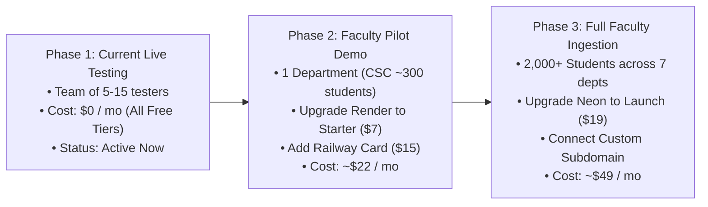

# FOCIT LMS - Production Infrastructure Scaling & Budget Plan
**Target Capacity:** 2,000+ Students & 100+ Academic Staff Members  
**Faculty:** Faculty of Computing & Information Technology (FOCIT), Osun State University (UNIOSUN)  
**Author:** Technical Architecture & Engineering Team  
**Status:** Approved for Implementation  

---

## 1. Executive Architecture Summary

To support **2,000+ students and all faculty staff**, the system does not require expensive on-premise blade servers or corporate enterprise licenses. 

Because of our decoupled modern architecture (**Vercel Edge CDN + Bounded Docker BFF Gateway + Serverless PostgreSQL & Redis + Dedicated Railway Moodle**), client static loads are offloaded to worldwide edge nodes, while stateful database transactions are isolated and connection-pooled in Western Europe (<100ms latency from Nigeria).

```mermaid
flowchart TD
    subgraph Clients["End Users (2,000+ Students & Staff)"]
        Mobile["Mobile Web Browsers"]
        Desktop["Desktop Laptops & PCs"]
    end

    subgraph EdgeCDN["Presentation Tier (Global Edge)"]
        Vercel["Vercel Edge CDN\n(portal.focit.edu.ng)\nReact SPA + Vite Build"]
    end

    subgraph GatewayTier["Application & API Gateway Tier (Frankfurt, EU)"]
        RenderBFF["Render Web Service (focit-bff)\nNode.js Express + Docker\nBulkhead Concurrency Gate"]
        Worker["Render Background Worker\nTransactional Outbox & Sweepers"]
    end

    subgraph PersistenceTier["Data & Integration Tier (Frankfurt & Amsterdam, EU)"]
        NeonDB[("Neon Serverless PostgreSQL\n(Frankfurt eu-central-1)\n43 Courses, Ledger, Users")]
        Upstash[("Upstash Managed Redis\nSession Nonce & Rate Limits")]
        RailwayMoodle[("Railway Moodle Engine\n(Amsterdam eu-west)\nPHP 8.2 + MariaDB + Storage")]
    end

    Mobile -->|HTTPS / CNAME| Vercel
    Desktop -->|HTTPS / CNAME| Vercel
    Vercel -->|/api/* Secure Reverse Proxy| RenderBFF
    RenderBFF -->|Connection Pooler (Port 5432)| NeonDB
    RenderBFF -->|TLS rediss://| Upstash
    RenderBFF -->|REST WS API (undici Pool)| RailwayMoodle
    Worker -->|Moodle Completion Worker| RailwayMoodle
    Worker -->|Transactional Outbox| NeonDB
```

---

## 2. Domain Name Architecture: Do We Need Multiple Domains?

> [!IMPORTANT]
> **NO. The faculty only needs ONE single root domain name.**
> You do **not** buy separate domains for Vercel, Render, and Railway. All platforms support unlimited free custom subdomains using standard DNS records.

### Recommended Domain Options

| Option | Provider | Estimated Cost | Notes |
| :--- | :--- | :---: | :--- |
| **Option A: Official University Subdomain** *(Recommended)* | UNIOSUN ICT / Directorate of Information Technology | **$0 / year (Free)** | Ask UNIOSUN ICT to delegate `focit.uniosun.edu.ng` or `lms.focit.uniosun.edu.ng`. Most authentic for students. |
| **Option B: Independent Faculty Domain** | Namecheap, Whogohost, or Porkbun | **$10 – $15 / year** | Acquire `uniosun-focit.edu.ng`, `focit-lms.ng`, or `focit-uniosun.com`. Provides 100% autonomous deployment control. |

### DNS Routing Matrix (How 1 Domain Powers Everything)

Once the root domain (e.g., `focit.edu.ng`) is registered, configure the following **DNS CNAME records** in Cloudflare / Namecheap DNS management:

| Subdomain | Record Type | Target Destination | Service Powered |
| :--- | :---: | :--- | :--- |
| **`portal.focit.edu.ng`** | `CNAME` | `cname.vercel-dns.com` | **Vercel** (Student, Lecturer, HOD, and Admin Web Portals) |
| **`api.focit.edu.ng`** | `CNAME` | `focit-bff-nqft.onrender.com` | **Render** (Express BFF Gateway & Reverse Proxy) |
| **`moodle.focit.edu.ng`** | `CNAME` | `moodle-production-2aab.up.railway.app` | **Railway** (Official Moodle Assessment Engine) |

---

## 3. Service-by-Service Scaling Analysis

### A. Vercel (Frontend Single Page Application)
* **What it does:** Serves pre-compiled React HTML, CSS, JavaScript, icons, and student dashboards.
* **Free Tier Allowance:** 100 GB global bandwidth per month; unlimited requests for static assets.
* **Why Free Works for 2,000+ Students:** The Vite bundle (~400 kB compressed) is downloaded **once** and cached in the student's phone browser. Subsequent page navigations load instantly from cache without generating network bandwidth.
* **Recommended Tier:** **Hobby ($0 / month)**. Only upgrade to Pro ($20/mo) if team collaborative preview workflows are requested.

### B. Render (Backend-For-Frontend API & Background Worker)
* **What it does:** Authenticates users, validates session nonces, signs JWT cookies, verifies attendance OTPs, and manages course registrations.
* **Free Tier Bottleneck:** Render Free instances automatically spin down (sleep) after 15 minutes of inactivity. When a student opens the app, the first request experiences a **50-second cold start lag**. Furthermore, 512 MB RAM and 0.1 CPU will choke under 100 simultaneous exam submissions.
* **Recommended Tier:** 
  * **Normal Semester Operations:** **Starter Web Service ($7 / month)**. Prevents sleep (always hot), 0.5 CPU, 512 MB RAM.
  * **Midterm / Exam Rush Weeks:** Scale temporarily to **Standard ($25 / month)** with 1 CPU and 2 GB RAM with 1 click.

### C. Railway (Moodle + MariaDB + Persistent Disk)
* **What it does:** Runs PHP 8.2, Apache, the MariaDB relational engine, and stores quiz question banks and assignment submissions.
* **Free Tier Bottleneck:** Railway free trial provides a one-time $5 credit that expires after ~7–10 days of continuous container operation. Moodle requires 24/7 uptime and persistent storage for `moodledata`.
* **Recommended Tier:** **Railway Usage Tier ($15 – $25 / month)**. Charges by actual resource usage (typically 1.5 GB RAM + 10 GB persistent disk volume).

### D. Neon (FOCIT Core PostgreSQL Database)
* **What it does:** Master authoritative database for all 43 accredited courses, student matric records, attendance ledgers, gradebook entries, and audit logs.
* **Free Tier Bottleneck:** Auto-suspends compute after 5 minutes of idle time and caps storage at 0.5 GB.
* **Recommended Tier:** **Neon Launch Plan ($19 / month)**. Guarantees zero compute sleep, 10 GB SSD storage, up to 10,000 pooled connections via PgBouncer, and 7-day automated point-in-time recovery.

### E. Upstash (Distributed Redis Cache & Session Nonce Store)
* **What it does:** Stores active student session tokens, attendance OTP HMAC validation secrets, and rate limit counters.
* **Free Tier Allowance:** 10,000 commands per day.
* **Recommended Tier:** **Pay-As-You-Go (~$2 – $5 / month)**. Charged at $0.20 per 100,000 commands. Absorbs massive 2,000-student attendance spikes effortlessly.

### F. Cloudflare R2 (PDF Lecture Notes & Past Questions Storage)
* **What it does:** Stores downloadable lecture slides, textbooks, and past exam question papers.
* **Why not local disk:** Render web containers have ephemeral disk storage (files vanish on redeployment).
* **Recommended Tier:** **Cloudflare R2 Free Tier ($0 / month)**. Includes 10 GB storage, 10 million reads/month, and **zero egress bandwidth fees**.

---

## 4. Total Monthly Production Budget

```
┌────────────────────────────────────────────────────────────────────────┐
│               TOTAL MONTHLY ESTIMATED INFRASTRUCTURE BUDGET            │
├────────────────────────────────┬─────────────────┬────────────────────┤
│ Service Component              │ Monthly Tier    │ Monthly Cost (USD) │
├────────────────────────────────┼─────────────────┼────────────────────┤
│ Vercel Frontend SPA            │ Hobby (Free)    │ $0.00              │
│ Render API Gateway (focit-bff) │ Starter Plan    │ $7.00              │
│ Railway Moodle Engine (LMS)    │ Usage Base      │ $20.00             │
│ Neon PostgreSQL Database       │ Launch Plan     │ $19.00             │
│ Upstash Redis Cache            │ Pay-As-You-Go   │ $3.00              │
│ Cloudflare R2 Document Store   │ Free Tier       │ $0.00              │
├────────────────────────────────┴─────────────────┼────────────────────┤
│ TOTAL ESTIMATED MONTHLY RUN RATE                 │ ~$49.00 / month    │
│ (In Nigerian Naira @ ₦1,450 / $1)                │ ~₦71,050 / month   │
└──────────────────────────────────────────────────┴────────────────────┘
```

> [!TIP]
> At ~₦71,000 per month for a faculty of 2,000 students, the infrastructure cost equates to approximately **₦35 per student per month** — less than 0.1% of faculty departmental operating expenses.

---

## 5. Phased Upgrade Roadmap



### Action Checklist: When to Upgrade Each Component

1. **Now (Current Testing Phase):**
   * Keep everything on the current free tiers.
   * Send `https://focit-lms-indol.vercel.app` to your team to test logins, course allocations, quizzes, and attendance.
   * **Cost: $0.**

2. **Before the Faculty Presentation / HOD Demo:**
   * Upgrade **Render to Starter ($7/mo)** so that when the Dean or HOD opens the link, the server responds in **<100ms** without any 50-second wake-up delay.

3. **When Railway Trial Credit Nears Expiration:**
   * Add a payment card to Railway to keep the Moodle engine running continuously.

4. **Before Ingesting All 2,000 Students for the Term:**
   * Upgrade **Neon to Launch ($19/mo)** to ensure high storage capacity and point-in-time database backups.
   * Add the custom domain (`focit.uniosun.edu.ng`) in Vercel and Render settings.
