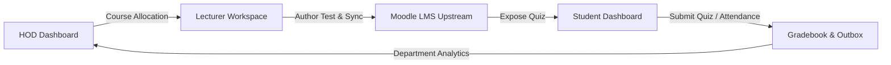

# FOCIT LMS — Architectural Evaluation & Implementation Roadmap
**Document Code:** FOCIT-ARCH-REV-2026-M11  
**Target:** Faculty of Computing & Information Technology (UNIOSUN) Engineering Team & Stakeholders  
**Status:** Approved for Implementation Planning  

---

## 1. Executive Summary & Priority Matrix

Based on the team meeting decisions, this document provides an engineering, security, and operational review of the six agenda items. 

The items have been evaluated against institutional requirements, security best practices (OWASP / Zero-Trust Doctrine), and rapid deployment viability for over 2,000 students and faculty staff.

### Implementation Priority Queue

| Priority | Feature / Decision | Effort | Impact | Risk If Deferred | Recommended Action |
| :---: | :--- | :---: | :---: | :---: | :--- |
| **P1** | **Item 3: End-to-End Inter-Dashboard Communication** | Medium | **Critical** | Product demo failure; broken sync | Verify & solidify Moodle-BFF-Client continuous sync pipeline. |
| **P2** | **Item 4: Multi-Lecturer Course Allocation (Primary/Secondary)** | Medium | **High** | Complex migration later once live data grows | Migrate database schema & HOD UI before bulk faculty allocations. |
| **P3** | **Item 5: Dynamic Student Attendance & Course Progress Bar** | Low | **High** | Student confusion over static progress metrics | Implement weighted progress formula based on live attendance + quizzes. |
| **P4** | **Item 2: Mobile / Tablet / iPad Responsive Hardening** | Medium | **High** | Poor student adoption on mobile phones | Audit & refine touch targets, drawer menus, and data table wrapping. |
| **P5** | **Item 6: Academic Semester State Machine & Detection** | Complete / Verified | **Institutional** | Semester cross-contamination | Document existing `academic_semesters` engine for stakeholders. |
| **P6** | **Item 1: Multi-Repository vs. Monorepo Security Strategy** | Architecture | **Governance** | High technical debt & code sync breakdown | Adopt monorepo with strict server-side RBAC (see Section 2). |

---

## 2. Decision 1 Evaluation: Separate Repositories vs. Unified Monorepo

### The Team's Premise
> *"Split dashboards on GitHub into separate repositories within an organization and deploy to different Vercel projects so they have different URLs. If hackers compromise the student dashboard, they will not have access to the staff/admin dashboards."*

### Architectural & Security Reality

```
                   ┌──────────────────────────────────────────────┐
                   │               THE BROWSER CLIENT             │
                   │  All JavaScript code is 100% public to users │
                   └──────────────────────┬───────────────────────┘
                                          │
                  HTTPS Request + JWT / Nonce Headers / Cookies
                                          ▼
                   ┌──────────────────────────────────────────────┐
                   │           BACKEND-FOR-FRONTEND (BFF)         │
                   │        Zero-Trust Cryptographic Barrier      │
                   ├──────────────────────────────────────────────┤
                   │  1. Ephemeral Nonce Verification (Redis)     │
                   │  2. HttpOnly Signed JWT Verification         │
                   │  3. Server-Side RBAC (requireRole Middleware)│
                   │  4. PostgreSQL Row-Level Course Allocation   │
                   └──────────────────────┬───────────────────────┘
                                          │
                                 Authorized / Denied
                                          ▼
                   ┌──────────────────────────────────────────────┐
                   │            POSTGRESQL & MOODLE API           │
                   └──────────────────────┬───────────────────────┘
```

> [!WARNING]
> **Splitting frontend code across repositories does not provide security isolation.**  
> In modern web applications, the frontend code is completely public. An attacker does not need an admin UI to attack an admin API; they can send raw HTTP requests directly via `curl` or Postman.

#### Why Security Lives Exclusively at the Backend
1. **Cryptographic Role Proof:** The server inspects the authenticated session (`req.user.role`). If a student session attempts to call `/api/admin/users`, `/api/hod/allocations`, or `/api/lecturer/courses`, the server rejects it with an immediate `403 Forbidden` (`FORBIDDEN_NOT_FACULTY` / `AUTH_REQUIRED`).
2. **Ephemeral Nonce Invalidation:** FOCIT LMS enforces dual-factor sessions (ambient HttpOnly cookie + `X-Session-Nonce` header verified in Redis). A student cannot forge or elevate this nonce.
3. **Database Row-Level Isolation:** Even if a user gains access to lecturer endpoints, the SQL query explicitly enforces `WHERE course_id = $1 AND lecturer_id = $2`, preventing Horizontal Privilege Escalation (IDOR / BOLA).

#### The Operational Costs of 5 Separate Repositories
1. **Code Duplication:** Shared UI components (`Topbar`, `Modal`, `Button`, `Table`, `PDFViewer`, Tailwind theme) would need to be copied across 5 repositories. A bug fix or branding change would require 5 separate pull requests and deployments.
2. **Session / Single Sign-On (SSO) Complexity:** Cookies cannot be shared effortlessly between disparate Vercel domains (`focit-student.vercel.app` vs `focit-admin.vercel.app`) without wildcard domain configuration (`*.focit.edu.ng`) or complex OAuth/OIDC redirects.
3. **Vercel Resource Limits:** Free/Hobby accounts face strict concurrency and project limits. Managing 5 projects increases deployment failures and configuration divergence.

### Recommended Direction
* **Maintain the Unified Monorepo:** Continue utilizing route-level code splitting (`React.lazy`) and declarative RBAC route guards (`RoleRouteGuard`).
* **Optional Institutional Domain Separation:** If the institution mandates separate URLs (e.g. `student.focit.edu.ng` and `staff.focit.edu.ng`), map custom domain subdomains to the same deployment with subpath rewrites, rather than fragmenting source code.

---

## 3. Decision 2: Mobile, Tablet & iPad Responsiveness

### Field Context
Over 80% of Nigerian university students and many lecturers access the portal primarily from smartphones (Android/iOS) and tablets.

### Tactical Implementation Plan
1. **Navigation Drawer:** Ensure the collapsible mobile hamburger navigation closes smoothly on outside tap or route transition without obstructing modal dialogs.
2. **Data Table Transformation:**
   - On screens `< 768px`, transform wide tabular lists (Course Registration ledger, Gradebook, Attendance roster) into stacked card layouts or horizontal swipeable containers with frozen first columns.
3. **Quiz & Question Bank Interface:**
   - Touch targets for quiz options must meet accessibility standards ($\ge 44 \times 44\text{px}$).
   - Disable accidental browser "pull-to-refresh" gestures during active exam attempts to protect unsubmitted answers.

---

## 4. Decision 3: Seamless Communication Across All Dashboards & Pages

### Core Value Pipeline
The LMS thrives on synchronized real-time data propagation across four distinct roles:



### Protocol Requirements
1. **TanStack React Query Cache Invalidation:** When an action completes on one page (e.g. HOD allocates a course), related cache keys (`['lecturer-courses']`, `['student-courses']`, `['hod-overview']`) must invalidate immediately without requiring a full browser refresh.
2. **Cross-Session Synchronization:** In addition to local single-tab cache invalidation, actions mutating shared academic state dispatch events over WebSocket/SSE notifications and the Redis pub/sub audit stream (`academic_audit_stream`). Remote browser sessions belonging to affected lecturers, advisors, or students automatically invalidate their active React Query caches in real time.
3. **Bi-Directional Moodle Outbox Logging:** Ensure failed upstream network calls queue into `moodle_sync_outbox` with exponential retry backoff, maintaining ACID database consistency locally even if Moodle experiences brief downtime.

---

## 5. Decision 4: Multi-Lecturer Course Allocation (Primary vs. Secondary)

### Institutional Requirement
In academic faculties, major courses (e.g. `CSC 202`, `MTH 102`) are co-taught:
* **Primary Lecturer (Course Coordinator):** Owns syllabus, authors tests in the Question Bank, coordinates grading, submits semester results to Senate.
* **Secondary Lecturer(s) (Co-Lecturers / TAs):** Takes lecture/lab attendance, grades individual assignments, reviews roster submissions.

### Current Database Constraint Blocker
In [`shared/db/migrations/014_hod_dashboard.sql`](shared/db/migrations/014_hod_dashboard.sql#L12):
```sql
CONSTRAINT uq_hod_alloc_course_semester UNIQUE (course_id, semester_id)
```
*Current behavior:* Only **one** lecturer can ever be assigned to a course per semester. Attempting to assign a second throws a unique constraint violation error (`23505`).

### Proposed Schema Migration (`021_multi_lecturer_allocations.sql`)
```sql
-- 1. Add lecturer role classification & preserve existing single-lecturer allocations as primary coordinators
ALTER TABLE hod_course_allocations 
ADD COLUMN IF NOT EXISTS is_primary BOOLEAN NOT NULL DEFAULT TRUE;

ALTER TABLE hod_course_allocations 
ALTER COLUMN is_primary DROP DEFAULT;

-- 2. Drop legacy single-lecturer unique constraint
ALTER TABLE hod_course_allocations 
DROP CONSTRAINT IF EXISTS uq_hod_alloc_course_semester;

-- 3. Allow multiple lecturers per course, but strictly unique per lecturer
ALTER TABLE hod_course_allocations 
ADD CONSTRAINT uq_hod_alloc_course_lecturer UNIQUE (course_id, semester_id, lecturer_id);

-- 4. Enforce business rule: Strictly ONE Primary Lecturer per course per semester
CREATE UNIQUE INDEX IF NOT EXISTS uq_hod_alloc_single_primary 
ON hod_course_allocations (course_id, semester_id) 
WHERE is_primary = TRUE;
```

---

## 6. Decision 5: Dynamic Student Attendance & Course Progress Bar

### Calculation Formula
Student progress displayed on dashboard course cards should not be static or mocked. It must dynamically reflect academic milestone achievements:

$$\text{Course Progress (\%)} = \left( 40 \times \text{Attendance Ratio} \right) + \left( 60 \times \text{Assessment Ratio} \right)$$

Where:
$$\text{Attendance Ratio} = \min\left(1.0, \frac{\text{Sessions Attended by Student}}{\max(1, \text{Total Locked Sessions Held by Lecturer})}\right)$$

$$\text{Assessment Ratio} = \min\left(1.0, \frac{\text{Quizzes Completed by Student}}{\max(1, \text{Total Published Active Quizzes})}\right)$$

### Implementation Plan
1. Update `GET /api/student/dashboard` and `GET /api/courses` to compute these two dynamic ratios via a single SQL `LEFT JOIN` on `attendance_records` and `quiz_submissions`.
2. Provide immediate visual feedback when a lecturer locks an attendance session or when a student completes a quiz drill.

---

## 7. Decision 6: How the System Detects the Active Semester

### Database Architecture
The system maintains an authoritative registry in [`academic_semesters`](packages/bff/src/db/migrations/002_academic_catalog_seed.sql#L38-L46):

```sql
CREATE TABLE academic_semesters (
    id VARCHAR(32) PRIMARY KEY,           -- '2026_RAIN', '2026_HARMATTAN'
    session_id VARCHAR(32) NOT NULL,      -- '2026/2027'
    semester_number INT NOT NULL,         -- 1 = Harmattan, 2 = Rain
    name VARCHAR(64) NOT NULL,            -- '2026/2027 Rain (Second) Semester'
    is_registration_open BOOLEAN NOT NULL -- TRUE = Current Active Semester
);
```

### Dynamic Runtime Resolution
* The BFF queries the active semester with:
  ```javascript
  const { rows } = await pool.query(
    `SELECT id, name, session_id, semester_number, is_registration_open
     FROM academic_semesters
     WHERE is_registration_open = TRUE
     ORDER BY created_at DESC
     LIMIT 1`
  );
  ```
* Every student registration batch, timetable slot, attendance session, and Moodle course mapping attaches foreign keys to `semester_id = '2026_RAIN'`.
* Switching semesters is an administrative operation that flips `is_registration_open = FALSE` on the old semester and `TRUE` on the new one, smoothly transitioning all catalog lookups across the university.

---

## 8. Immediate Next Steps & Decision Points for the Team

1. **Monorepo Confirmation:** Share Section 2 with the team to finalize keeping the unified codebase with server-side RBAC.
2. **Schema Migration Approval:** Approve the migration plan in Section 5 so we can deploy the multi-lecturer allocation schema (`is_primary` flag) and update the HOD Allocation modal.
3. **Dynamic Progress Bar Rollout:** Implement the weighted progress formula in Section 6.
