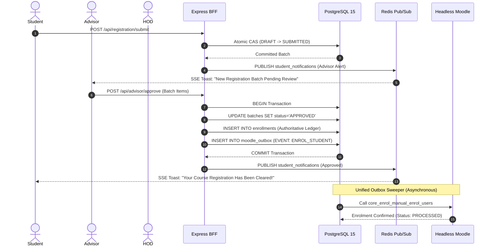

# FOCIT LMS: Master System Architecture & Operational Guide
**Faculty of Computing & Information Technology (FOCIT) — Osun State University (UNIOSUN)**

---

## Table of Contents
1. [Executive Summary & System Overview](#1-executive-summary--system-overview)
2. [Part 1: Student Operational Guide (Plain English)](#2-part-1-student-operational-guide-plain-english)
   - [2.1 Logging In & Account Security](#21-logging-in--account-security)
   - [2.2 Your Student Dashboard](#22-your-student-dashboard)
   - [2.3 Course Registration Step-by-Step](#23-course-registration-step-by-step)
   - [2.4 Accessing Course Materials & Lecture Notes](#24-accessing-course-materials--lecture-notes)
   - [2.5 Taking Quizzes & Tests Safely](#25-taking-quizzes--tests-safely)
   - [2.6 Submitting Assignments](#26-submitting-assignments)
   - [2.7 Checking Your Grades & Academic Standing](#27-checking-your-grades--academic-standing)
   - [2.8 Class Discussion Forums](#28-class-discussion-forums)
   - [2.9 Updating Your Profile & Notification Preferences](#29-updating-your-profile--notification-preferences)
3. [Part 2: Developer Architectural Blueprint](#3-part-2-developer-architectural-blueprint)
   - [3.1 System Topology & The Dual-Engine Model](#31-system-topology--the-dual-engine-model)
   - [3.2 Role-Based Access Control (RBAC) Matrix](#32-role-based-access-control-rbac-matrix)
   - [3.3 The Lecturer Dashboard Specification](#33-the-lecturer-dashboard-specification)
   - [3.4 The Head of Department (HOD) Dashboard Specification](#34-the-head-of-department-hod-dashboard-specification)
   - [3.5 The Faculty Admin & Dean Dashboard Specification](#35-the-faculty-admin--dean-dashboard-specification)
   - [3.6 Inter-Dashboard Communication & State Synchronization](#36-inter-dashboard-communication--state-synchronization)
   - [3.7 Headless Moodle Synchronization (The Outbox Engine)](#37-headless-moodle-synchronization-the-outbox-engine)
4. [Part 3: Project Manager (PM) Blueprint & Delivery Roadmap](#4-part-3-project-manager-pm-blueprint--delivery-roadmap)
   - [4.1 Vision, Scope & Value Proposition](#41-vision-scope--value-proposition)
   - [4.2 Phased Milestone Roadmap & Critical Path](#42-phased-milestone-roadmap--critical-path)
   - [4.3 Systemic Risk Register & Mitigation Strategy](#43-systemic-risk-register--mitigation-strategy)
   - [4.4 Senate Compliance & Institutional Quality Gates](#44-senate-compliance--institutional-quality-gates)

---

## 1. Executive Summary & System Overview

The **FOCIT LMS** is an enterprise academic and learning management ecosystem tailored specifically for the Faculty of Computing & Information Technology at Osun State University. 

### The Core Architectural Principle: The Dual-Engine Model
To achieve institutional stability, security, and scalability, the portal operates on a strict **Separation of Concerns**:
1. **FOCIT Academic Core (The Administrative Control Plane)**:
   - Built with **Node.js/Express (BFF)**, **PostgreSQL 15**, and **Redis 7**.
   - Serves as the single source of truth for student identities, departmental hierarchies, course catalogs, prerequisites, credit limits, official course registration approvals, and Senate transcript records.
2. **Headless Moodle (The Learning Delivery Engine)**:
   - Functions exclusively behind the scenes via authenticated Moodle Web Services APIs.
   - Serves as the repository for actual lecture slide decks/PDFs, interactive quizzes, student assignment uploads, discussion forums, and raw assessment scores.
   - Students and staff **never log directly into Moodle’s native interface**; all interactions flow through the custom React 19 single-page application.

---

## 2. Part 1: Student Operational Guide (Plain English)

*Welcome to the FOCIT LMS. This section explains how to use your portal for your daily academic activities in simple, clear steps.*

```
      ┌───────────────────────────────────────────────────────────┐
      │                   STUDENT PORTAL LIFECYCLE                │
      └─────────────────────────────┬─────────────────────────────┘
                                    │
       1. Sign In ──► 2. Dashboard ──► 3. Course Registration
                                                │ (Draft -> Submit -> Approved)
                                                ▼
       7. Final Grades ◄── 6. Quizzes ◄── 5. Materials & Notes ◄── 4. Enrolled
```

### 2.1 Logging In & Account Security
1. **Navigating to the Portal**: Open your web browser (Chrome, Edge, Safari, or Firefox) and visit the portal link.
2. **Your Credentials**:
   - **Student ID / Matric Number**: Enter your university matriculation number (e.g., `FOCIT/2024/0042`) or assigned student ID (e.g., `student1`).
   - **Password**: Enter your institutional password.
3. **First-Time Sign-In (Forced Password Reset)**:
   - If you have just been admitted or your account was recently provisioned, the portal will immediately ask you to change your temporary password.
   - For your safety, the portal will lock access to courses and registration until you set a new, private password.

### 2.2 Your Student Dashboard
Once signed in, the Dashboard is your central academic home. You will see:
* **Academic Greeting & Term Badge**: Displays your name, department, current level (e.g., 200 Level), and the active semester (e.g., Rain Semester 2026).
* **Key Metrics**:
  * **Registered Courses**: How many courses you are taking this semester.
  * **Units Registered**: Total credit load.
  * **Academic Standing (GPA)**: Your current cumulative standing. *(Note: By Senate policy, 100-level and direct-entry 200-level students will see this field marked as foundational until departmental transcripts are finalized).*
* **Active Courses List**: A list of all modules you are taking, complete with a visual progress bar indicating your lecture and material completion percentage.
* **Upcoming Deadlines**: Announcements for upcoming quizzes, assignment deadlines, or virtual classrooms.

### 2.3 Course Registration Step-by-Step
Course registration is the legal contract between you, your department, and the university. Follow these 4 steps:

#### Step 1: Open Registration
* Click **Course Registration** in the left sidebar menu.
* The system will detect your level and semester and present all available courses (Compulsory Core, Departmental Electives, and General Studies/GST).

#### Step 2: Select Your Courses (Save as Draft)
* Click the checkbox next to each course you intend to take.
* As you pick courses, the **Credit Counter** at the top updates automatically.
* **Important Senate Rules Enforced by the Portal**:
  * **Minimum Limit**: You must register for at least **12 units**.
  * **Maximum Ceiling**: You cannot register for more than **24 units** in a semester.
  * **Level Rules**: You cannot select courses higher than your current academic level.
* Click **Save Draft** at any time. Your selections are safely saved, and you can close your browser and come back later without losing your choices.

#### Step 3: Formal Submission to Level Advisor
* When your course list is complete and within credit bounds (12–24 units), click **Submit for Approval**.
* Read the declaration statement and confirm.
* Once submitted, your registration batch changes to **SUBMITTED** and is locked from editing while waiting for your Level Advisor.

#### Step 4: Tracking Your Advisor's Clearance
* Return to the Course Registration page at any time to see your status:
  * 🟡 **Pending Advisor Review**: Your Level Advisor has been notified and is inspecting your courses.
  * 🟢 **Approved**: Your Level Advisor cleared your courses! You are now officially enrolled in the courses and learning materials will unlock automatically.
  * 🔴 **Returned / Rejected**: If your advisor notices an issue (such as a missing prerequisite or wrong elective), they will return your registration with written remarks explaining what to correct. You can edit your courses and re-submit.

### 2.4 Accessing Course Materials & Lecture Notes
1. Click **Courses** on the sidebar and select any of your enrolled courses (e.g., `CSC 204: Data Structures and Algorithms`).
2. Click the **Materials** tab.
3. You will see lecture materials grouped by topic and week.
4. **Reading Slides & PDFs**:
   - Click **Preview** to open and read lecture slides directly inside the browser.
   - Click **Download** to save a copy to your phone or laptop for offline study.
5. **Progress Tracking**: As you open materials, your completion checkbox is checked automatically, updating your course progress on the dashboard.

### 2.5 Taking Quizzes & Tests Safely
Continuous assessments and midterm tests are delivered through the Quiz engine:
1. Open your course and click the **Quizzes** tab.
2. Select an active quiz to open the **Quiz Attempt Screen**.
3. **The Live Timer**: Once you begin, a countdown timer starts in the header. The timer synchronizes continuously with university servers—closing your browser tab or refreshing the page **will not stop or reset the clock**.
4. **Auto-Saving Answers**: As you select your answers (A, B, C, or D), the portal automatically saves each answer in the background every few seconds.
5. **Connection Dropout Protection**: If your cellular internet drops for 30 seconds, your selections remain safely stored in your device's memory. When your signal reconnects, the portal syncs your answers automatically.
6. **Submitting**: Click **Submit Quiz** when finished. If your time expires before you click submit, the system locks the quiz and automatically submits all answers you selected up to that exact second.

### 2.6 Submitting Assignments
1. On the course page, select the **Assignments** tab.
2. Review the assignment title, lecturer's instructions, maximum score, and the submission deadline.
3. Click **Upload Submission**.
4. Select your file (PDF or Word document up to 10MB) or type your text answer.
5. Click **Confirm Submission**. You will receive an instant digital timestamp confirming your submission was recorded before the deadline.

### 2.7 Checking Your Grades & Academic Standing
1. Click **Gradebook** on the sidebar or open the Grades tab in any course.
2. You will see an itemized breakdown:
   * Class Quizzes & Tests (e.g., 30% of total)
   * Assignments & Lab Practicals (e.g., 10% of total)
   * Final Examination Score (e.g., 60% of total)
   * Weighted Course Total and Letter Grade (A, B, C, D, or F).

### 2.8 Class Discussion Forums
1. Click **Forums** to enter your course discussion board.
2. Browse questions posted by your course lecturer and fellow classmates.
3. Use the search bar to find answers to specific programming bugs, math equations, or assignment questions.
4. Click **New Topic** to ask a question to the class.

### 2.9 Updating Your Profile & Notification Preferences
1. Click **Profile** on the sidebar or click your avatar at the top right.
2. **Profile Photo**: Upload a clean, professional headshot. The portal automatically crops and optimizes the photo for your student ID badge.
3. **Contact Details**: Keep your phone number and alternate personal email address up to date so the department can reach you in case of emergencies.
4. **Preferences**: Turn email digests, quiz deadline reminders, or SMS alerts on or off.

---

## 3. Part 2: Developer Architectural Blueprint

*This section provides technical specifications for software engineers building the Lecturer, Head of Department (HOD), and Faculty Admin dashboards, detailing system topology, state machines, API contracts, and background data synchronization.*

```
 ┌─────────────────────────────────────────────────────────────────────────────┐
 │                       FOCIT LMS ARCHITECTURAL TOPOLOGY                      │
 └─────────────────────────────────────────────────────────────────────────────┘

       React 19 Frontend SPA (Vite / Tailwind / Native Semantic HTML)
     ┌─────────────────────────────────────────────────────────────┐
     │  Student Shell  │  Advisor Shell  │  Lecturer  │  HOD/Dean  │
     └────────┬─────────────────┬─────────────┬───────────┬────────┘
              │                 │             │           │
              ▼                 ▼             ▼           ▼
   ════════════════════════════════════════════════════════════════════════════
                        HTTP/HTTPS Reverse Proxy & Cookie Guard
   ════════════════════════════════════════════════════════════════════════════
                                      │
                                      ▼
                        Express BFF API (Port 3000)
    ┌─────────────────────────────────────────────────────────────────────────┐
    │ • Global Rate Limiting Gate      • Fetch Metadata Perimeter Guard       │
    │ • RBAC Authorization Middleware  • Ephemeral Nonce Proof Verification   │
    │ • Error Boundary (RFC 7807)      • Monolithic Controller / Service Mesh │
    └──────────┬──────────────────────┬───────────────────────┬───────────────┘
               │                      │                       │
               ▼                      ▼                       ▼
      PostgreSQL 15 Core           Redis 7              Unified Outbox Worker
   ┌───────────────────────┐  ┌───────────────┐     ┌────────────────────────┐
   │ • Academic Hierarchy  │  │ • Session Map │     │ • FOR UPDATE SKIP LOCK │
   │ • Course Catalogs     │  │ • Token Nonce │────►│ • Moodle Client Pool   │
   │ • Registration FSM    │  │ • SSE Stream  │     │ • Idempotent Retries   │
   │ • Moodle Outbox Queue │  │ • Rate Limits │     └───────────┬────────────┘
   └───────────────────────┘  └───────────────┘                 │
                                                                ▼
                                                       Headless Moodle REST
                                                      (Port 3001 or Cloud WS)
```

### 3.1 System Topology & The Dual-Engine Model
* **Client**: React 19 single-page application using `@tanstack/react-query` and `@tanstack/react-virtual`.
* **Backend for Frontend (BFF)**: Node.js 20+ / Express 4.21.
* **Authoritative Store (PostgreSQL 15)**: Holds all relational models, foreign-key constraints, check constraints, and transactional outbox queues.
* **Transient Store (Redis 7)**: Session storage (`session:<sessionId>`), ephemeral session nonces, circuit breaker trip states, and real-time Pub/Sub channels.
* **Upstream Integration (Moodle WS Engine)**: Communicates via pooled HTTP keep-alive connections (`undici`) to Moodle’s `webservice/rest/server.php`.

### 3.2 Role-Based Access Control (RBAC) Matrix

| Endpoint Namespace | STUDENT | LEVEL_ADVISOR | LECTURER | HOD | ADMIN / DEAN |
| :--- | :---: | :---: | :---: | :---: | :---: |
| `/api/student/*` | ✅ Own Record | ❌ | ❌ | ❌ | 👁️ Audit View |
| `/api/registration/*` | ✅ Own Draft | ❌ | ❌ | ❌ | 👁️ Read-Only |
| `/api/advisor/*` | ❌ | ✅ Assigned Level | ❌ | ✅ Dept Level | ✅ All Levels |
| `/api/lecturer/*` | ❌ | ❌ | ✅ Assigned Courses | ❌ | 👁️ Dept Overview |
| `/api/hod/*` | ❌ | ❌ | ❌ | ✅ Own Dept | 👁️ Faculty View |
| `/api/admin/*` | ❌ | ❌ | ❌ | ❌ | ✅ Full Admin |
| `/api/courses/:id/materials` | 👁️ Read | 👁️ Read | ✍️ Write/Upload | 👁️ Read | ✍️ Manage |
| `/api/courses/:id/grades` | 👁️ Own Grade | 👁️ Cohort View | ✍️ Grade / Submit | ✍️ Endorse | 👁️ Audit View |

---

### 3.3 The Lecturer Dashboard Specification

The Lecturer Dashboard empowers instructors to manage instructional content, grade continuous assessments, and review quiz performance.

```
┌────────────────────────────────────────────────────────────────────────┐
│                        LECTURER DASHBOARD FLOW                         │
└──────────────────────────────────┬─────────────────────────────────────┘
                                   │
      ┌────────────────────────────┼────────────────────────────┐
      ▼                            ▼                            ▼
Course Allocation            Assessment Engine             Moodle Outbox
┌──────────────────┐       ┌──────────────────┐       ┌──────────────────┐
│ Assigned Modules │       │ • Question Bank  │       │ Push Materials   │
│ Student Rosters  │       │ • Score Input CA │       │ Sync Quiz Grades │
│ Material Upload  │       │ • Forum Topics   │       │ Publish Notices  │
└──────────────────┘       └──────────────────┘       └──────────────────┘
```

#### Key Components to Build:
1. **Assigned Courses Overview (`/lecturer/courses`)**:
   - Displays all courses allocated to the lecturer for the active academic session.
   - Shows live student enrollment counts directly from PostgreSQL `enrollments`.
2. **Material Publishing Station (`/lecturer/courses/:courseId/materials`)**:
   - Drag-and-drop file uploader for lecture slides, PDFs, code files.
   - Form for week number, title, and description.
   - Enqueues a `MOODLE_FILE_SYNC` event to the `moodle_outbox` table.
3. **Continuous Assessment Grading Ledger (`/lecturer/courses/:courseId/gradebook`)**:
   - Tabular spreadsheet of enrolled students.
   - Inputs for Test 1 (15%), Test 2 (15%), Lab Practical (10%).
   - Atomic batch save with optimistic concurrency lock (`version` check).
4. **Question Bank & Quiz Creator (`/lecturer/courses/:courseId/quizzes`)**:
   - Leverages existing `question_bank` and `quizzes` schemas.
   - Lets lecturers create randomized assessments, pick question categories, and set closing deadlines.

#### Required REST API Endpoints (`packages/bff/src/routes/lecturer.js`):
```http
GET    /api/lecturer/courses               Fetch assigned courses & enrollment stats
GET    /api/lecturer/courses/:id/roster     Fetch enrolled students list
POST   /api/lecturer/courses/:id/materials  Upload material (multipart/form-data)
PUT    /api/lecturer/courses/:id/grades     Batch save CA grades
POST   /api/lecturer/courses/:id/quizzes    Create/schedule a new quiz
```

---

### 3.4 The Head of Department (HOD) Dashboard Specification

The HOD Dashboard serves as the academic governance hub for the department (e.g., Computer Science, Cyber Security, Software Engineering).

#### Key Components to Build:
1. **Course Allocation Matrix (`/hod/allocations`)**:
   - Lists all departmental courses for the active semester.
   - Dropdown selectors assigning verified departmental academic staff to each course.
   - Updates `course_allocations` table in PostgreSQL.
2. **Registration Clearance Escalation Desk (`/hod/clearance-escalations`)**:
   - Receives students whose registration was flagged or escalated by Level Advisors (e.g., requests for credit overload up to 26 units).
   - HOD approval applies a cryptographic override bypass.
3. **Departmental Result Endorsement Station (`/hod/results`)**:
   - Displays compiled semester results sheets per course.
   - Highlighting anomalies: Failure rates $>40\%$, missing Continuous Assessment marks.
   - Action: **Endorse Results for Senate Review** (transitions results to `HOD_APPROVED`).
4. **Cohort Academic Analytics (`/hod/analytics`)**:
   - Visual distribution of student GPAs across 100L, 200L, 300L, and 400L.
   - At-risk student identification (students with CGPA $<1.50$ facing probation).

#### Required REST API Endpoints (`packages/bff/src/routes/hod.js`):
```http
GET    /api/hod/courses/allocations         List current allocations
POST   /api/hod/courses/allocate            Assign lecturer to course
GET    /api/hod/clearance/escalations       List escalated registration cases
POST   /api/hod/clearance/override          Execute HOD clearance override
GET    /api/hod/results/summary             Fetch department results ledger
POST   /api/hod/results/endorse             Endorse results batch to Dean/Senate
```

---

### 3.5 The Faculty Admin & Dean Dashboard Specification

The Faculty Admin and Dean Dashboard provides systemic configuration, faculty-wide oversight, and academic integrity management.

#### Key Components to Build:
1. **Academic Calendar & Session Manager (`/admin/academic-calendar`)**:
   - Start / Close academic sessions (e.g., `2026/2027`).
   - Open / Close registration windows (`is_registration_open = TRUE / FALSE`).
2. **Faculty Course Catalog Editor (`/admin/catalog`)**:
   - Add new courses, set course unit values, core vs elective classifications.
   - Define hard prerequisites (e.g., `CSC 204` requires `CSC 101`).
3. **Timetable Collision & Room Ingestion Desk (`/admin/timetable`)**:
   - Powered by Migration `013_timetable_gist_exclusion_and_ingestion.sql`.
   - Uses PostgreSQL GiST exclusion constraints (`tsrange && tsrange`) to mathematically prevent booking the same lecture hall at the same time or scheduling two core courses for the same cohort simultaneously.
4. **Security & Identity Audit Inspector (`/admin/audit-logs`)**:
   - Powered by Migration `007_identity_security_audit_ledger.sql`.
   - Reads the append-only, tamper-evident `identity_audit_logs` table.
   - Verifies sequential cryptographic SHA-256 hash chains (`entry_hash`), proving no administrator or actor has altered security logs.

---

### 3.6 Inter-Dashboard Communication & State Synchronization

The dashboards communicate seamlessly using a unified event-driven state architecture:



1. **Relational Triggers & State Machines**:
   - When a Level Advisor approves a registration batch, the transaction atomically creates active rows in the `enrollments` table and enqueues an asynchronous sync event into `moodle_outbox`.
2. **Real-Time Notification Pipeline (SSE & Redis)**:
   - The BFF runs a Redis Pub/Sub channel (`student_notifications`).
   - When an advisor approves or rejects a registration, an event is published to Redis.
   - Active client browser instances connected to `/api/student/notifications/stream` immediately receive a Server-Sent Event (SSE) and pop an accessible toast notification on the student's screen without requiring a page reload.

---

### 3.7 Headless Moodle Synchronization (The Outbox Engine)

The synchronization pipeline between FOCIT and Moodle uses the **Transactional Outbox Pattern** to prevent split-brain states and distributed transaction failures:

```
[BFF HTTP Request] ──► [BEGIN PostgreSQL Transaction]
                           ├── 1. Update Core Academic State
                           └── 2. INSERT INTO moodle_outbox (Status: PENDING)
                       [COMMIT Transaction]
                                │
   ┌────────────────────────────┴─────────────────────────────┐
   │                                                          │
[Client Receives 200 OK]                          [Unified Outbox Worker]
                                                  Every 5000ms:
                                                  SELECT * FROM moodle_outbox
                                                  WHERE status = 'PENDING'
                                                  FOR UPDATE SKIP LOCKED;
                                                              │
                                                  Call Moodle Web Services API
                                                              │
                                                  ├── Success ──► UPDATE status = 'PROCESSED'
                                                  └── Failure ──► UPDATE retry_count + 1
                                                                  Exponential Backoff Jitter
```

* **Zero Direct Synchronous Calls in User Requests**: The user's browser never waits for Moodle. The API responds in milliseconds because the Moodle call is queued in the database.
* **Worker Execution (`packages/bff/src/workers/unifiedOutboxWorker.js`)**:
  - Uses `FOR UPDATE SKIP LOCKED` to allow multiple concurrent worker instances to scale horizontally without duplicate event execution.
  - Features exponential backoff with full jitter to protect Moodle during high-traffic registration periods.

---

## 4. Part 3: Project Manager (PM) Blueprint & Delivery Roadmap

*This section provides project managers and academic stakeholders with the operational timeline, critical path, risk register, and acceptance criteria.*

### 4.1 Vision, Scope & Value Proposition
* **Institutional Goal**: Transition the Faculty of Computing & Information Technology from fragmented manual course forms and raw Moodle screens to an integrated, audit-compliant academic digital platform.
* **Key Metric Targets**:
  * 100% elimination of paper-based course registration clearance slips.
  * Sub-2-second end-to-end response time for all student portal operations.
  * Zero course registration over-enrollment breaches via mathematical database constraints.
  * 100% compliance with Senate grading and foundational GPA policies.

### 4.2 Phased Milestone Roadmap & Critical Path

```
Q1 2026               Q2 2026               Q3 2026               Q4 2026
┌──────────────────┐  ┌──────────────────┐  ┌──────────────────┐  ┌──────────────────┐
│  MILESTONE 1 & 2 │  │   MILESTONE 3    │  │   MILESTONE 4    │  │  MILESTONES 5 & 6│
│ • Database Schema│  │ • Advisor Ledger │  │ • Lecturer Dash  │  │ • Full Cloud Go- │
│ • BFF Auth Core  │──► • Outbox Worker  │──► • HOD Result Desk│──►   Live           │
│ • Student Portal │  │ • UI Ergonomics  │  │ • Dean Oversight │  │ • Moodle Cloud WS│
│   (COMPLETED)    │  │   (COMPLETED)    │  │   (Next Sprint)  │  │   (Production)   │
└──────────────────┘  └──────────────────┘  └──────────────────┘  └──────────────────┘
```

| Phase | Deliverable | Status | Dependencies | Target Timeline |
| :--- | :--- | :---: | :--- | :--- |
| **Phase 1** | Academic Catalog, Auth Handshake, PostgreSQL Core | **COMPLETED** | DB Instance | Sprint 1 |
| **Phase 2** | Student Dashboard, Registration FSM, Materials Proxy | **COMPLETED** | Phase 1 | Sprint 2 |
| **Phase 3** | Quizzes, Gradebook, Profiles, Level Advisor Clearance | **COMPLETED** | Phase 2 | Sprint 3 |
| **Phase 4** | 8-8-8 Hardening, Component Shell Decomposition ($<180$ lines) | **COMPLETED** | Phase 3 | Sprint 4 |
| **Phase 5** | Lecturer Dashboard & Question Bank Builder | **NEXT** | Phase 4 | Sprint 5 |
| **Phase 6** | HOD Allocation Desk, Dean Oversight & Senate Audit Engine | **PENDING** | Phase 5 | Sprint 6 |
| **Phase 7** | Production Moodle Cloud Cutover & Penetration Audit | **PENDING** | Phase 6 | Sprint 7 |

---

### 4.3 Systemic Risk Register & Mitigation Strategy

| Risk ID | Risk Description | Severity | Probability | Built-In Architectural Mitigation |
| :---: | :--- | :---: | :---: | :--- |
| **R-01** | **Network Dropouts on 3G Cellular Connections**: Students lose answers during midterm tests or quiz submissions. | **HIGH** | **HIGH** | Client-side monotonic intra-tick timer with `sessionStorage` draft sandbox and transparent 503 exponential backoff re-drive. |
| **R-02** | **Course Capacity Over-Enrollment Race Condition**: Multiple students submit the last available seat simultaneously. | **CRITICAL** | **MEDIUM** | Strict PostgreSQL check constraint (`chk_course_capacity`) and atomic `FOR UPDATE` row-level locking during registration transactions. |
| **R-03** | **Advisor Clearance Bottleneck**: Thousands of students waiting for a single advisor before exams. | **HIGH** | **HIGH** | Bulk Approval Dock with lexicographically sorted Dijkstra concurrency locks, allowing advisors to clear 50 students in 1 click. |
| **R-04** | **Cross-Site Cookie Discard on Cloud Deployments**: Browsers blocking `HttpOnly` auth cookies when Vercel calls Render. | **HIGH** | **HIGH** | Vercel Edge Proxy rewrite in `vercel.json` routing all `/api/*` traffic through the same domain origin. |
| **R-05** | **Moodle Service Unavailability**: Moodle container crashes during heavy load. | **MEDIUM** | **MEDIUM** | Transactional Outbox Pattern with Redis Circuit Breaker fast-failing into `OPEN` state; student operations never fail. |

---

### 4.4 Senate Compliance & Institutional Quality Gates
1. **The 100L/200L Foundational Exemption**:
   - The portal strictly enforces Senate rules whereby direct-entry and 100-level students do not have premature, incomplete GPA calculations broadcast until the conclusion of the second semester.
2. **The 12–24 Credit Bound Constraint**:
   - Course registration blocks any student from submitting less than 12 units or more than 24 units without formal HOD/Dean escalation overrides.
3. **WORM Cryptographic Security Audit Ledger**:
   - All role promotions, login failures, clearance actions, and grade modifications append an immutable entry to `identity_audit_logs`.
   - PostgreSQL triggers physically block any SQL `UPDATE` or `DELETE` command on this table, guaranteeing tamper-proof institutional accountability for accreditation audits.

---
*Document Version: 1.0.0 (Production Release Candidate)*  
*Faculty of Computing & Information Technology (FOCIT) — Osun State University*
